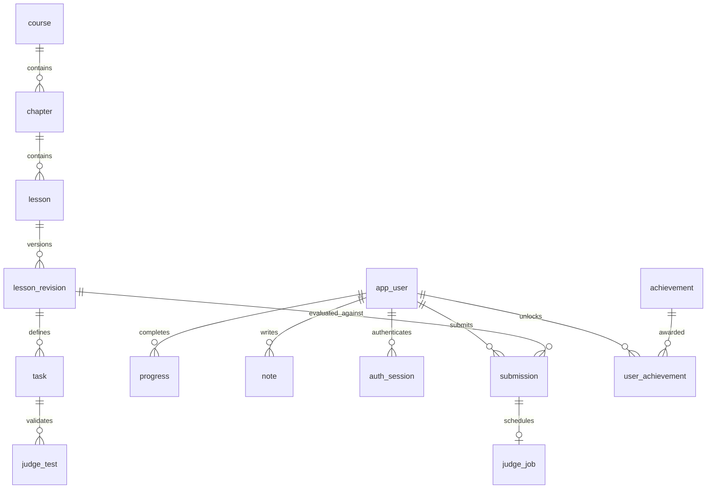

# 架构、数据与接口

原 Docker 架构见下文；后续新增了显式的受信任本地进程判题模式。它没有安全沙盒边界，详见 [判题模式切换](JUDGE-MODES.md)。只有 Docker 模式提供下述容器限制；本地模式仍将学习者代码放在独立子进程，而不是 API JVM 中。

## 服务边界
浏览器 Vue 3/TS/Vite/Pinia/Router/Monaco → 同源 /api → Java 21/Spring Boot 3.5 REST → MySQL 8.4。
API → 内网带共享密钥 HTTP → 独立 Python 标准库判题协调服务 → 每个测试创建一次无网络 Java 21 Docker 容器。

使用 Python 是为了保持判题编排轻量；Java 编译与执行只发生于受限容器，主 API 不持有 Docker socket。只有可信协调进程有 Docker 权限。Docker socket 等同主机管理权限，禁止向公网暴露协调服务；本地仅绑定回环地址。生产需专用工作节点与强隔离运行时。

首版同步提交，用户每 2 秒一次，API/判题分别有并发上限；繁忙返回明确错误。后续升级持久队列与轮询。测试使用可信课程输入与预期输出，比较规范化换行和末尾空白，不执行客户端提供的测试。进度唯一键(user_id, lesson_id)且事务提交；重复通过不增加 XP。课程 JSON 驱动，revision 随发布变化；后续独立课程表与管理端，不在首版制造空 CRUD。

## 隔离限制
容器：非 root uid 65534、read-only rootfs、仅 /work 64MiB tmpfs 可写、network none、cap-drop ALL、no-new-privileges、pids 64、CPU 1、内存/交换上限 256MiB、Java heap 96MiB、最大输出 64KiB、编译 15 秒/运行 3 秒、全流程超时 25 秒。清除 Java 相关注入变量；不挂载宿主目录、凭据或 Docker socket；每次测试独立临时容器，finally 强制删除。默认 Docker seccomp 保持启用。非可用时 fail closed，绝不回退到宿主 javac。

源文件最多 8 个，只允许平面 Java 标识符文件名，必须有 Main.java；总字符上限 32KiB。不能防御所有 JVM/内核漏洞。首版输出判题可被硬编码，因此只适用于相应初学输出练习，不宣称防作弊。方法/算法等后续需隐藏参数化测试。

## 数据库
Flyway V1 是规范初始化脚本，API 启动自动迁移：
- app_user：id、唯一规范化 email、display_name、BCrypt password_hash、created_at。
- auth_session：SHA256 token_hash 主键、user_id 外键、expires_at；浏览器只保存随机 256-bit HttpOnly/SameSite=Strict cookie。
- submission：id、user_id、lesson_id、代码 JSON、结果 JSON、status、created_at。所有读取绑定 user_id。
- progress：user_id/lesson_id 复合主键、首次 completed_at；XP 由已通过课程求和。
- draft：user_id/lesson_id 复合主键、files_json、updated_at；浏览器草稿辅助缓存，服务器为跨会话来源。
- note：user_id/lesson_id 复合主键、body、updated_at。
课程章节/关卡/任务当前在版本化 JSON 中；数据库课程表/版本表属于阶段 3 管理需求。有效学习时长/完整成就表未实现，不展示虚构统计。

## REST 接口（详细 schema 见运行时 /v3/api-docs 和 /swagger-ui.html）
| 方法/地址 | 用途 | 权限 |
|---|---|---|
| GET /api/health | API/数据库活性 | 公共 |
| GET /api/lessons | 公共课程、教学、starter（不返回测试） | 公共 |
| POST /api/auth/register | email/password/name 注册，建立 session | 公共，限流 |
| POST /api/auth/login | 登录建立 session | 公共，限流 |
| POST /api/auth/logout | 撤销 session | 登录 |
| GET /api/me | 用户、进度、XP、提交统计 | 登录 |
| POST /api/submissions | {lessonId, files:[{name,content}]}，真实同步判题 | 登录、顺序解锁、限流 |
| GET /api/submissions | 最近 50 条个人提交 | 登录 |
| GET/PUT /api/drafts/{lessonId} | 多文件草稿读取/保存 | 登录 |
| GET /api/notes | 私人笔记 | 登录 |
| PUT /api/notes/{lessonId} | {body} 保存私人笔记 | 登录 |

JSON 错误统一 {message}；输入失败400、未登录401、未解锁403、缺失404、频率/容量429、判题不可用503。CSRF 防护：所有更改请求必须带 X-Quest-Client: 1，自定义 header 跨域需预检，只放行配置的前端 origin；cookie SameSite Strict。开发默认 HTTP cookie，生产需 TLS + COOKIE_SECURE=true。没有密码找回/邮件验证/跨设备 session 管理，不能作为生产认证完备性的声明。

## 维护策略
数据库迁移只新增不修改已发布版本；课程 id 稳定。前端不包含预期答案。单元/集成测试验证认证、权限、持久化、失败不通关、重复通关幂等。独立黑盒脚本验证 Docker 编译、运行、超时和网络隔离；浏览器端验证编辑与刷新。发布镜像需固定摘要；本地 compose 使用可读 tag，首次拉取的实际 digest 应记录在验证报告。

## 完整课程平台的数据演进设计（尚未建表）

以下是后续迁移的设计，不是当前数据库已具备的能力。阶段 1 的固定 10 关保存在版本化 JSON，以减少早期管理系统的成本。

| 拟建表 | 核心字段与关系 | 约束与用途 |
|---|---|---|
| course | id, slug, title, description, level, status, sort_order | slug 唯一，草稿/发布/归档状态 |
| chapter | id, course_id, title, sort_order | 外键 course，课程内顺序唯一 |
| lesson | id, chapter_id, slug, kind, difficulty, xp, prerequisite_id | 稳定 id，显式前置依赖，避免长期依赖数组序号 |
| lesson_revision | id, lesson_id, version, content_json, starter_json, published_at | 发布后不可变，提交绑定版本，方便复现和回滚 |
| task | id, lesson_revision_id, prompt, validator_type, limits_json | 任务与验证器配置，参数由可信服务端读取 |
| judge_test | id, task_id, visibility, input_json, expected_json, weight | 隐藏测试只提供给可信判题服务，不能进入公共接口 |
| achievement | id, code, title, description, rule_json | code 唯一，规则版本化 |
| user_achievement | user_id, achievement_id, unlocked_at | 复合唯一键，后台幂等授予 |
| learning_event | id, user_id, lesson_revision_id, event_type, occurred_at, payload_json | 只存必要数据；服务器校验，不把浏览器停留时长直接计作学习 |
| review_schedule | user_id, lesson_id, due_at, interval_days, mastery | 复习安排与掌握程度，不直接把失败次数等同能力 |
| project | id, course_id, title, starter_revision, rubric_json | 综合项目验收指标与版本 |
| project_submission | id, user_id, project_id, judge_job_id, result_json | 项目评分和基础关卡提交分开管理 |
| judge_job | id, submission_id, status, attempts, lease_until, worker_id | 队列 worker 领取租约；重试不重复计分 |

现有 submission 增加 lesson_revision_id/judge_job_id；progress 增加状态与对应通过版本，旧课程通关不能因为内容编辑悄悄消失。note 后续可拆为多条笔记并增加 revision 引用。所有外键、唯一键和用户过滤都通过迁移与集成测试保证。

上图 app_user/submission/progress/note/auth_session 已实现；其他实体及 revision 外键属于设计。

## 后续接口与交互协议（尚未实现）

- GET `/api/v1/courses`、`/courses/{slug}/chapters`、`/lessons/{id}/revisions/{version}`：分页与已发布课程读取；公共视图严格过滤隐藏测试。
- POST `/api/v1/judge-jobs`、GET `/judge-jobs/{id}`：异步 202 + job id，所有权校验，前端轮询/事件通知；离开页面后可恢复结果。
- GET `/api/v1/reviews?dueBefore=...`、POST `/reviews/{lessonId}/attempts`：复习计划与复习结果；不能直接写 mastery。
- GET `/api/v1/search?q=...`：只检索公开课程与当前用户笔记，不泄露其他账户内容。
- POST `/api/v1/learning-events`：有限白名单事件/去重 id/频率限制，采集需有清晰隐私说明。
- GET/POST `/api/v1/admin/courses`、POST `/admin/lessons/{id}/revisions`、POST `/admin/revisions/{id}/publish`：管理员角色校验、审核、乐观锁与审计；发布前在可信沙盒运行课程自测。
- Maven 配置任务采用 XML 安全解析（禁止外部实体/外部 DTD）、语义断言与受控构建；Spring 实验服务运行在临时隔离网络，仅由可信 HTTP 测试器访问；并发题采用可重放事件记录与确定性同步测试。以上都需独立 runner，不扩展成主 API 内执行代码。

## 可选的无 Docker 本地学习模式

`--spring.profiles.active=local` 启用内嵌 H2/MySQL 兼容模式文件数据库，自动执行同一份 Flyway 初始迁移。默认路径固定为 `${user.home}/.java-quest/javaquest`，可用 QUEST_DATA_DIR 覆盖；H2 不依赖独立数据库进程，数据与原 MySQL 分离，不自动迁移。API 本地监听 127.0.0.1。

GET `/api/capabilities` 下发配置状态 judgeEnabled，前端依据此字段显示本地模式说明并禁用提交。local 默认 false，后端也在执行之前拒绝，绝不在主机执行代码或生成成功结果。H2 驱动是 runtime 依赖并嵌入可运行 jar；此模式不要求判题 token。若显式设置 JUDGE_ENABLED=true，仍强制校验 token 长度并调用独立判题服务，保留完整模式的资源隔离边界。judgeEnabled 仅表示配置开关，不保证远端服务健康。

## 双模式 Java 判题服务

Maven 额外生成 classifier=judge 的独立可执行 jar，入口 JudgeMain，无 Spring/数据库启动；API 入口保持 QuestApplication。JudgeRunner 统一校验源文件、测试协议和结果，选择 process/docker；无自动降级。process 构建器为当前 JDK 的绝对路径，分别启动 javac/java，用有界 stdout/stderr 和 deadline 监督，环境变量白名单过滤只是减少误泄露，不是权限隔离。docker 则启动一次性受限容器，将自建的受控平面文件 tar 通过 docker exec 的 stdin 写入 tmpfs，保留 read-only rootfs，不挂载宿主路径。Java 协调器与原 Python Docker 协调器兼容同一判题协议。

模式在受信任启动配置中选择：off/process/docker/remote。进程模式需要 --allow-local-process，协调器核对 X-Judge-Mode 后才执行；API 验证 process 响应必须声明 process，防止错误配置被显示为容器隔离。启动脚本为本次拥有的 API/判题进程生成短期随机 token，退出时只停止自己启动的进程。三个本机模式默认使用同一 H2 文件，而不是把数据库选择和判题运行器绑定。其他电脑的数据不会自动同步。

## 层级课程与 Java 源码项目

curriculum.json 保存 Stage/Chapter/Topic/Exercise，Exercise.lessonId=null 表示规划；lessons.json 只包含可运行教学。两者发布时验证一一映射、源文件/入口、完整讲解、可编辑文件与依赖 DAG。prerequisites 使用稳定课程 ID，展示 order 不再决定解锁，因此扩充目录不需要重置现有用户。

项目文件仅接受安全相对 .java 路径，长度最多 96 字符，拒绝绝对路径、反斜线、点段、Windows 设备名与大小写重复。最多 8 文件/32KiB 字符、1–5 组可信测试，保持现有资源预算。源码写入新临时目录或 Docker tmpfs，编译时用 -d . 输出包目录，运行器使用服务器指定的 entryClass。旧请求入口默认 Main。

课程 editableFiles 描述允许修改的初始文件；API 在保存草稿和判题前强制保留其他初始文件内容，也要求全部初始文件存在。前端根据相同数据将调用方设为只读。额外帮助类允许添加；参考实现在 test resources 中用于作者 QA，不作为 API 响应。数据驱动不意味着自动生成正确课程，作者必须提供讲解、任务、起始失败、参考成功和边界测试证据。
